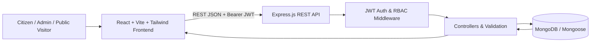

# CivicLedger — Transparent Local Governance & Budgeting

A full-stack **MERN** (MongoDB, Express.js, React, Node.js) civic transparency and participatory budgeting portal enabling citizens to inspect municipal budgets, track department expenditures, submit community development proposals, cast tamper-resistant democratic votes, monitor infrastructure projects, and download financial reports.

> **Sample / Demo Data Notice:** All seeded financial figures, municipal departments, proposals, and projects included for initial testing represent clearly labeled **Sample / Demonstration Data** (`CivicLedger Demo Municipality`). They are never presented as real-world government expenditure.

---

## Problem Statement
Local residents often struggle to understand how municipal taxes are allocated across public services, how much has actually been spent mid-year, whether neighborhood infrastructure projects are on schedule, or how citizens can propose and prioritize community initiatives.

## Proposed Solution
**CivicLedger** unifies public financial transparency and participatory democracy in a single role-based web platform:
- **Public Visitors** gain immediate, login-free access to published annual budgets, department spending ledgers, project progress timelines, voting standings, and CSV/printable reports.
- **Registered Citizens** can submit community proposals with estimated budgets and supporting documents, vote once per approved initiative, submit feedback/complaints, and receive status notifications.
- **Government Administrators** manage annual budgets, departments, fund allocations, proposal approvals, project milestones, expenditure records, citizen accounts, and feedback tickets through a dedicated console.

---

## Core Features
1. **JWT & bcrypt Authentication:** Citizen self-registration, secure login, role-based route protection (`citizen`, `admin`), and profile/password management.
2. **Public Budget Dashboard:** Interactive Recharts visualizations (allocation vs. spending bar charts, allocation share donut chart, monthly spending trend), utilization progress bars, fiscal-year selector, and live activity feed.
3. **Budget & Department Management:** Admin creation of annual budgets, department registration, fund allocation validation (cannot exceed total budget ceiling), and draft-to-published publishing.
4. **Citizen Proposal Submission & Review:** Six civic categories (`Roads and transportation`, `Education`, `Healthcare`, `Drinking water`, `Sanitation`, `Parks and public facilities`), file uploads (`multer`) + URL links, and admin workflow (`Pending` → `Under Review` → `Approved`/`Rejected`/`Completed`) with optional one-click conversion to a tracked project.
5. **Participatory Budgeting & Voting:** Ranked live voting leaderboard, deadline countdown, and **database-enforced unique compound index** (`{ proposal, citizen }`) preventing duplicate votes.
6. **Government Spending Tracker:** Searchable, filterable, and sortable ledger of expenditures with automatic project spend updates.
7. **Development Project Tracking:** Progress bars, start/expected completion dates, contractor info, and chronological milestone update logs.
8. **Reports & Analytics:** Printable reports (`@media print`) and downloadable CSV exports (`budget`, `spending`, `projects`, `voting`).

---

## Technology Stack
- **Frontend:** React 18, Vite, Tailwind CSS, React Router v6, Recharts, Lucide React, Axios
- **Backend:** Node.js, Express.js, Mongoose ODM, JWT, bcryptjs, Multer, Helmet, CORS, Express Rate Limit, Express Validator
- **Database:** MongoDB Atlas (with `mongodb-memory-server` option for zero-config offline local testing)
- **Testing:** Node.js built-in test runner (`node --test`) + Supertest + Postman collection
- **Deployment:** Vercel (Frontend), Render (Backend), MongoDB Atlas (Database)

---

## System Architecture



See [docs/architecture.md](docs/architecture.md) for all 10 architecture views and Mermaid sequence/ERD diagrams.

---

## Database Structure (9 Mongoose Models)
1. `User` — Accounts, bcrypt-hashed passwords, `citizen`/`admin` roles, ward, active flag.
2. `Department` — Municipal departments, unique codes, department heads, chart colors.
3. `Budget` — Annual fiscal budgets, `draft`/`published`/`archived` statuses, department allocations array.
4. `Expenditure` — Line-item transactions linked to Budget, Department, and optional Project.
5. `Proposal` — Citizen proposals, categories, attachments, review status, vote counter.
6. `Vote` — Citizen votes with unique compound index `{ proposal: 1, citizen: 1 }`.
7. `Project` — Public works projects, completion percentage, milestone update history.
8. `Feedback` — Citizen/visitor inquiries and complaints with admin responses.
9. `Notification` — Per-user alerts for proposal decisions and feedback responses.

---

## Repository Structure

```text
transparent-local-governance-budgeting/
├── frontend/
│   ├── src/
│   │   ├── components/
│   │   ├── context/
│   │   ├── layouts/
│   │   ├── pages/
│   │   ├── services/
│   │   └── utils/
│   ├── index.html
│   ├── tailwind.config.js
│   ├── vite.config.js
│   └── package.json
├── backend/
│   ├── config/
│   ├── controllers/
│   ├── middleware/
│   ├── models/
│   ├── routes/
│   ├── tests/
│   ├── utils/
│   ├── app.js
│   ├── server.js
│   └── package.json
├── docs/
│   ├── architecture.md
│   ├── api-documentation.md
│   └── postman_collection.json
├── render.yaml
├── README.md
└── .gitignore
```

---

## Local Setup & Installation

### 1. Prerequisites
- Node.js v18+ (tested on Node v26)
- npm v9+
- MongoDB Atlas connection string (or use `USE_IN_MEMORY_DB=true` for zero-setup local evaluation)

### 2. Backend Setup
```bash
cd backend
npm install
cp .env.example .env
# Edit .env: set MONGODB_URI (or set USE_IN_MEMORY_DB=true) and a strong JWT_SECRET
npm run seed   # Optional when using external MongoDB; auto-seeds if AUTO_SEED_DEMO=true
npm run dev    # Starts API server on http://localhost:5000
```

### 3. Frontend Setup
```bash
cd frontend
npm install
cp .env.example .env
npm run dev    # Starts Vite dev server on http://localhost:5173
```

### Demo Credentials (Sample Dataset)
- **Government Administrator:** `admin@civicledger.demo` / `AdminPassword123!`
- **Registered Citizen:** `citizen@civicledger.demo` / `CitizenPassword123!`

---

## Testing

### Automated API Integration Tests
```bash
cd backend
npm test
```
Tests cover citizen registration, login, role-based access control, budget creation/publishing, fund allocation, proposal submission/approval, duplicate vote prevention (`409 Conflict`), expenditure recalculation, project progress updates, privacy protection on public routes, CSV export, and feedback responses.

### Postman Testing
Import [docs/postman_collection.json](docs/postman_collection.json) into Postman and inspect full endpoint specs in [docs/api-documentation.md](docs/api-documentation.md).

---

## Deployment Instructions

### 1. Database (MongoDB Atlas)
1. Create a free M0 cluster on [MongoDB Atlas](https://www.mongodb.com/atlas).
2. Create a database user and allow network access (`0.0.0.0/0` for Render dynamic IPs).
3. Copy your `mongodb+srv://...` connection URI.

### 2. Backend (Render)
1. Push this repository to GitHub under `transparent-local-governance-budgeting`.
2. In Render, click **New + → Blueprint** (uses `render.yaml`) or **Web Service** pointing to `backend/`:
   - Build Command: `npm install`
   - Start Command: `npm start`
   - Env Vars: `MONGODB_URI`, `JWT_SECRET`, `CLIENT_URL=https://<your-vercel-app>.vercel.app`, `CORS_ORIGINS=https://<your-vercel-app>.vercel.app`, `USE_IN_MEMORY_DB=false`, `AUTO_SEED_DEMO=true`.
3. Note your Render URL (e.g., `https://civicledger-api.onrender.com`).

### 3. Frontend (Vercel)
1. In Vercel, import the same GitHub repository and set **Root Directory** to `frontend`.
2. Add Environment Variable: `VITE_API_URL=https://<your-render-service>.onrender.com/api`.
3. Deploy — `frontend/vercel.json` handles SPA routing automatically.

---

## Screenshots
_Add captured screenshots of your live deployment before challenge submission:_
- Public Budget Dashboard (`docs/screenshots/public-dashboard.png`)
- Participatory Voting Ballot (`docs/screenshots/voting-ballot.png`)
- Administrator Console (`docs/screenshots/admin-console.png`)

---

## Future Enhancements
- Multi-language civic localization (i18n).
- Geolocation map pins for neighborhood proposals and projects.
- Email / SMS digest notifications for ward residents.
- Audit log export with cryptographic hash verification.
