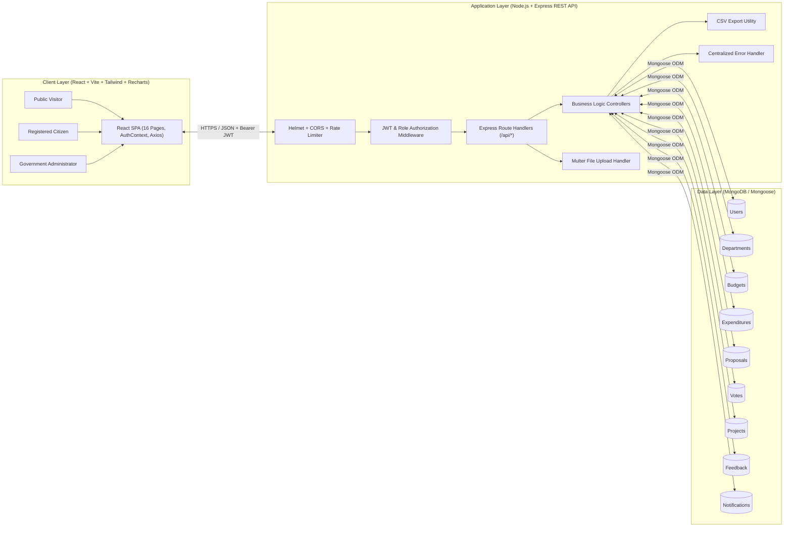
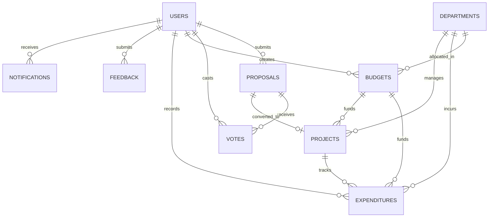
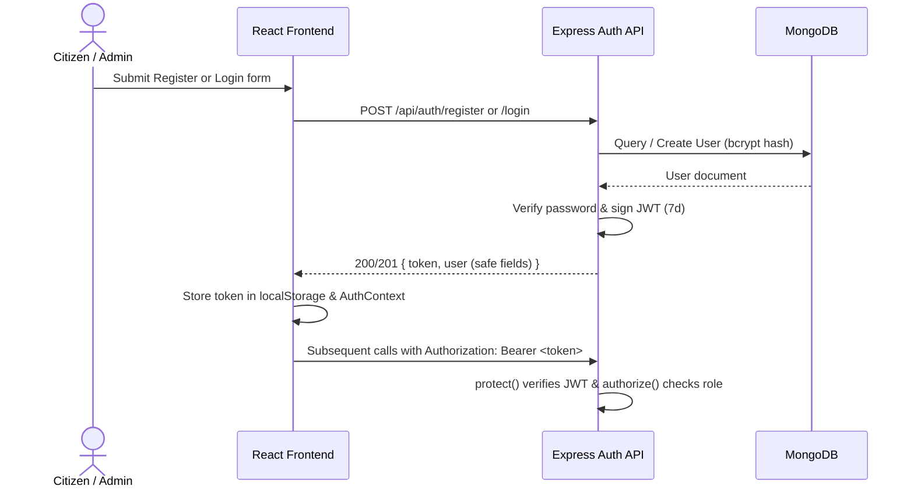
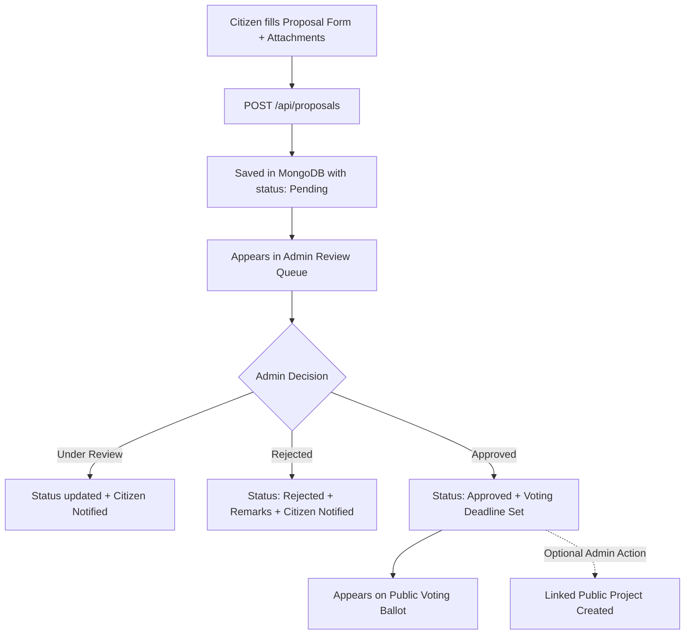
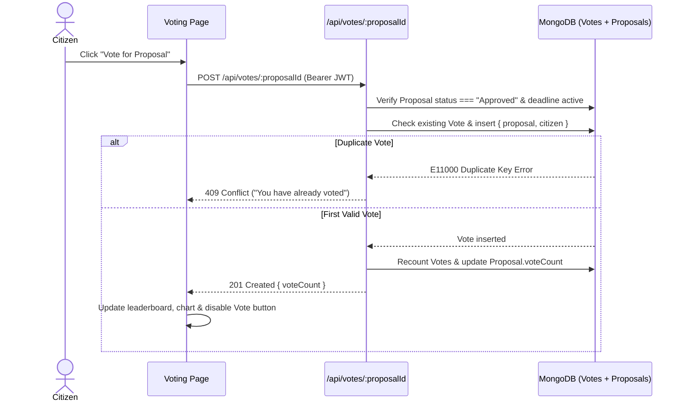
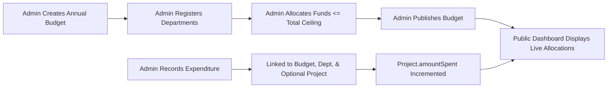
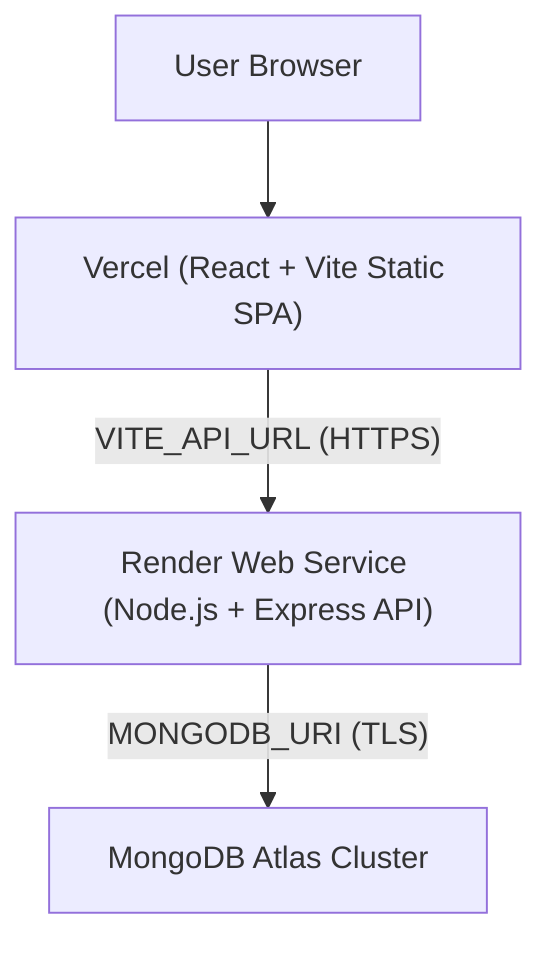

# System Architecture — Transparent Local Governance & Budgeting (CivicLedger)

> **Data Disclaimer:** All initial seeded datasets in this system represent clearly labeled **sample / demonstration municipal data** and must not be interpreted as real-world government expenditure.

---

## 1. System Architecture Diagram

### End-to-End Request Data Flow

`Citizen/Admin → React Frontend → Express REST API → Authentication Middleware → Controllers → MongoDB → API Response → React Dashboard`

---

## 2. Frontend Architecture

- **Framework & Tooling:** React 18 with Vite, Tailwind CSS, React Router v6, Recharts, Lucide React, and Axios.
- **State & Context:**
  - `AuthContext` (`frontend/src/context/AuthContext.jsx`): Persists JWT token and safe user metadata in `localStorage`, validates sessions on load via `GET /api/auth/me`, and exposes `isAuthenticated`, `isAdmin`, `login`, `register`, `logout`, and `unreadNotifications`.
  - `ToastContext` (`frontend/src/context/ToastContext.jsx`): Global accessible toast feedback for API successes and errors.
- **Layouts & Route Guards:**
  - `MainLayout`: Public & Citizen shell containing the demonstration disclaimer bar, responsive `Navbar` with notifications bell, `<Outlet />`, and `Footer`.
  - `AdminLayout`: Dedicated administration shell with collapsible sidebar (`Overview`, `Budget Allocation`, `Department Spending`, `Citizen Proposals`, `Project Tracking`, `Reports & Analytics`, `Feedback Desk`, `Citizen Accounts`).
  - `ProtectedRoute`: Enforces authentication and optional `requireAdmin` role verification before rendering protected routes.

---

## 3. Backend Architecture

Organized cleanly inside `backend/`:

- `config/db.js`: Connects to MongoDB Atlas (`MONGODB_URI`) or `mongodb-memory-server` when `USE_IN_MEMORY_DB=true`.
- `models/`: 9 Mongoose schemas with field validation, timestamps, indexes, and unique constraints.
- `middleware/`:
  - `auth.js`: `protect`, `optionalAuth`, `authorize(...roles)`, `signToken`.
  - `errorHandler.js`: `validateRequest` (`express-validator`), `notFoundHandler`, and centralized `errorHandler` translating Mongoose duplicate keys (`11000`), validation errors, and Multer limits into clean JSON responses.
  - `upload.js`: Multer disk storage with MIME type allowlist and 5 MB per-file cap.
- `controllers/` & `routes/`: Dedicated REST modules for Auth, Users/Notifications, Departments, Budgets, Expenditures, Proposals, Votes, Projects, Feedback, and Reports.
- `utils/`: `AppError`, `asyncHandler`, `csvExport` (formula-injection safe CSV serializer), `notify`, and `seedData`.

---

## 4. Database Architecture (ERD)

### Key Integrity Constraints
- `User.email`: Unique, lowercase, indexed; `password` uses `select: false` and `bcryptjs` salt-10 hashing.
- `Vote`: Compound unique index `{ proposal: 1, citizen: 1 }` enforcing **one vote per citizen per proposal** at the database engine level (`409 Conflict` on duplicate attempt).
- `Proposal.submittedBy` on public endpoints populates only `name` and `ward` — never `email`, `phone`, or `address`.

---

## 5. Authentication Workflow

---

## 6. Citizen Proposal Workflow

---

## 7. Participatory Voting Workflow

---

## 8. Budget Management & Spending Workflow

---

## 9. API Architecture Summary

| Resource | Base Path | Public Access | Authenticated Citizen | Admin Only |
|---|---|---|---|---|
| Auth | `/api/auth` | Register, Login | Me, Profile, Password | — |
| Users | `/api/users` | — | My Notifications | List Users, Suspend/Activate |
| Departments | `/api/departments` | List Active | List Active | Create, Update |
| Budgets | `/api/budgets` | Published List & Dashboard | Published List & Dashboard | Create, Update, Publish, Allocate |
| Expenditures | `/api/expenditures` | Search, Filter, Sort Ledger | Search, Filter, Sort Ledger | Record, Delete |
| Proposals | `/api/proposals` | List & View (public fields) | Submit Proposal | Update Status / Remarks |
| Votes | `/api/votes` | View Ballot & Standings | Cast Vote, My Votes | Cast Vote |
| Projects | `/api/projects` | List & Track Progress | List & Track Progress | Create Project, Update Progress |
| Feedback | `/api/feedback` | Submit Inquiry/Complaint | View Own Tickets | View All & Respond |
| Reports | `/api/reports` | Summary JSON & CSV Export | Summary JSON & CSV Export | Summary JSON & CSV Export |

---

## 10. Deployment Architecture

- **Frontend (Vercel):** Serves optimized static assets built via `npm run build` with `vercel.json` SPA fallback rewrites.
- **Backend (Render):** Runs `node server.js` configured via `render.yaml` and environment variables (`MONGODB_URI`, `JWT_SECRET`, `CORS_ORIGINS`).
- **Database (MongoDB Atlas):** Managed cloud cluster storing all 9 collections with TLS encryption and automated indexing.
